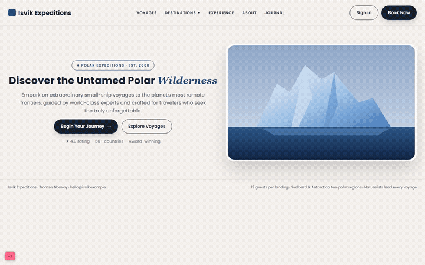

# Sitemaxxing

Give your website a glow-up. Sitemaxxing points at a running site, splits it into sections,
gives it a **Mog score** (first-impression appeal, 0 to 100), and proposes changes from coarse
to fine: a whole-page **direction**, then the **ten day-one techniques**, then **component
variants**. Every change previews live on your real dev server with an outline and a label; copy
types in letter by letter. You approve, reject or pick a variant. **Commit** squashes the approved
changes into one real git commit and a new version. Every decision is logged, so later versions
can learn your taste.



Local-first, no account, no telemetry, MIT. Bring your own model (or none: every pass except the
copy rewrite works offline).

## Quick start

```sh
pnpm i
npx playwright install chromium
pnpm dev
```

`pnpm dev` builds the packages, copies both sample sites into `.playground/` (each with its own
git history, so commits never touch this repo), and starts everything:

| Port | What |
|---|---|
| 4747 | Control room |
| 3333 | Hub: MCP at `/mcp`, WebSocket at `/live`, overlay at `/overlay.js` |
| 5173 | Fieldnote, a sloppy SaaS landing page |
| 5174 | Isvik Expeditions, a sloppy travel landing page |

Open http://localhost:4747, hover a row to preview it, pick variants, approve, and press Commit.

### On your own Vite + React site

```sh
npm i -D sitemaxxing
npx sitemaxxing init --dev-url http://localhost:5173   # writes sitemaxxing.config.ts, adds the Vite plugin
npm run dev                                             # your dev server, with the overlay injected
npx sitemaxxing dev                                     # hub + control room
```

Non-Vite sites add one line in development only:
`<script src="http://localhost:3333/overlay.js"></script>`.

### With Claude Code

```sh
claude mcp add sitemaxxing --transport http http://localhost:3333/mcp
```

Then: `audit_page` → `preview_pass` → `decide_pass` → `commit_version`. Agents that edit code
directly can call `report_pass` to highlight what they changed in the overlay.

### CLI

```
sitemaxxing init [path] --dev-url <url>     register a project
sitemaxxing dev [path]                      MCP + WebSocket hub + control room
sitemaxxing audit [path] [--json]           Mog score and proposed passes (CI-friendly)
sitemaxxing commit [path]                   same as the Commit button
sitemaxxing export [path] --timelapse out.mp4   one frame per pass, labelled
```

## What it changes

| # | Pass | What it detects | What it does | Points |
|---|---|---|---|---|
| 0 | **Direction** (3 variants) | gradients, competing hues, decorated buttons | palette, accent and tone as tokens; solid buttons, no gradients, hairline badges | +16 |
| 1 | Declutter | pills, badge rows, two equal CTAs, sign-in next to the CTA, 5+ nav links | one primary action per view; nav capped at 3 to 4 links | +8 |
| 2 | Spacing | many distinct values, hero padding under 48px | 4/8-pt scale with fluid `clamp()` values | +5 |
| 3 | Copy | slop words, emoji, 25+ word subheads, stacked adjectives | one concrete claim; subhead halved and made specific; buttons say what happens; emoji cards become a spec row | +10 |
| 4 | Alignment | more than two left edges, centred body text, centred nav | one grid, one left edge; nav links right | +4 |
| 5 | Font (3 variants) | a default or ubiquitous geometric sans everywhere; faux italics | a characterful display face plus a neutral text face, self-hosted | +6 |
| 6 | Font size | h1 under 2.5× body, zero tracking, long lines | a real scale, tight display tracking, 16 to 20px body, mono labels | +7 |
| 7 | Imagery | boxed card image, blobs, emoji art | one strong image or art element, full-bleed with a contrast overlay | +7 |
| 8 | Navigation (5 variants) | plain dropdown, overloaded nav | preview tiles, fullscreen reveal (circle, curtain, split) or side drawer | +6 |
| 9 | Arrow shift button (2 variants) | no hover feedback | arrow nudges 4px, or sits in a disc and rotates | +4 |
| 10 | Reveal hero (3 variants) | no entrance, or everything fading in | line rise, word stagger or blur in; reduced motion respected | +5 |
| C | Hero art: dot field (3 variants) | static art | morphing shapes, dot globe or field wave, pointer-reactive | +12 |
| C | Preloader (3 variants) | none | counter wipe, split curtain or image stack | +3 |

Every pass is a plugin written against the API in `packages/core` and cites rule cards from
design writing and research (`packages/rules/cards`, CC BY 4.0). Passes that do not apply are
shown as skipped with the reason. Rejecting an upstream pass marks its dependents stale and offers
Regenerate; nothing regenerates without a click.

## Architecture

```
Intake → Generate → Rank → Stage (live) → Commit → Learn ─┐
                     ▲                                     │
                     └─────────────────────────────────────┘
```

```
control room (4747) ──┐
overlay.js in site ───┼── hub (3333): MCP + WebSocket ── Engine ── patches ── your working tree
Claude Code (MCP) ────┘                                   │            └── git commit per version
                                                          └── SQLite: passes, variants, versions,
                                                              decisions, scores
```

- `apps/control-room`: the dark studio UI. `apps/sample-*`: the two sloppy sample sites.
- `packages/core`: types, plugin API, patch queue, versions, decision log, LLM adapters, DB.
- `packages/passes`, `packages/components`, `packages/rules`: the built-in passes, the original
  component sources they write into your repo, and the rule cards.
- `packages/mog-score`: the transparent heuristic. `packages/overlay`, `packages/vite-plugin`:
  the dev-only overlay. `packages/mcp-server`: the hub. `packages/cli`: `sitemaxxing`.

More in [docs/architecture.md](docs/architecture.md), [docs/writing-a-pass.md](docs/writing-a-pass.md)
and [docs/mog-score.md](docs/mog-score.md). The plan this was built from is in [docs/PLAN.md](docs/PLAN.md).

## Bring your own model

Only the Copy pass uses an LLM, with a strict template (one claim, no slop words, numbers only
from the page). Set `ANTHROPIC_API_KEY` or `OPENAI_API_KEY`, or point `llm.provider: 'local'` at
an OpenAI-compatible endpoint such as Ollama with `SITEMAXXING_LOCAL_LLM`. Without a key the pass
makes a rule-based rewrite and says so. Outputs are cached by input hash under
`.sitemaxxing/cache/`.

## Contributing

Adding a pass, a component or a rule card is the point. See [CONTRIBUTING.md](CONTRIBUTING.md).
Everything in this repo is original work: no code or designs from paid component libraries.

## Roadmap

| Phase | Scope |
|---|---|
| 1 (this release) | repo mode, overlay, control room, direction + ten techniques + components, Mog score v1, patch queue, commits and versions, MCP server, decision log, plugin API |
| 2 | taste engine: walls of 12 options per section, 60-second calibration, personal Bradley–Terry offset, fit / stretch / wildcard slots, taste card |
| 3 | any-URL mode: capture, rebuild as code, visual match %, hand off to repo mode |
| 4 | opt-in crowd baseline, saturation index, lifecycle stages, trend clock in ranking |
| 5 | public ledger of named trend calls, shareable taste cards |

## License

MIT for all code. Rule cards in `packages/rules/cards` are CC BY 4.0. Fonts are self-hosted
under the SIL Open Font License via Fontsource.
